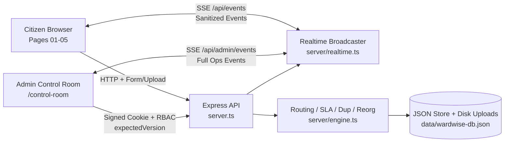

# WARDWISE — Municipal Civic-Tech System Architecture

## 1. Platform Overview
**WARDWISE** is a full-stack municipal civic issue management and public accountability platform built with React 19, TypeScript, Tailwind CSS v4, and an Express Node.js backend persisted to a structured JSON datastore (`data/wardwise-db.json`) with uploaded evidence stored on disk (`data/uploads/`).

The platform maintains a strict **5 + 1 interface boundary**:
- **5 Public Pages**: `/` (Home), `/report` (Report an Issue), `/map` (Live City Map), `/track` (Track My Issue), `/transparency` (Transparency Portal).
- **1 Private Authenticated Admin Control Room**: `/control-room` (hidden from public navigation; gated by signed HMAC-SHA256 HTTP-only session cookies and server-enforced RBAC).

---

## 2. Page-by-Page Architecture
| Page | Route | Purpose | Primary Data Sources |
| --- | --- | --- | --- |
| **01. Home** | `/` | Interactive city dispatch hero, 4-stage lifecycle, ward health snapshot, escalation simulator, duplicate/reorg preview, scoreboard preview | `GET /api/public/bootstrap`, SSE `/api/events` |
| **02. Report an Issue** | `/report` | 5-step guided intake (`Category` -> `Details & Severity` -> `Photo Evidence` -> `Location & Ward Map` -> `Review & Confirmation Docket`) | `POST /api/uploads`, `POST /api/public/complaints` |
| **03. Live City Map** | `/map` | 12-ward GIS map (`Standard` / `Contrast` / `Satellite`), telemetry filter sidebar, category chips, cluster badges, right issue drawer, list toggle, DB pattern insights | `GET /api/public/bootstrap`, SSE `/api/events` |
| **04. Track My Issue** | `/track` | Complaint ID search & quick picks, 4-stage pipeline, SLA burn bar, 3-tier escalation ladder, before/after photo hashes, 5-star + rectification review, audit JSON export | `GET /api/public/complaints/:id`, `POST /api/public/complaints/:id/feedback`, SSE `/api/events` |
| **05. Transparency** | `/transparency` | `30d` / `QTD` / `Annual` accountability portal, Rank #1 spotlight, Department Leaderboard, 50/25/25 methodology, 12-ward stress grid, charts, CSV/JSON open data | `GET /api/public/bootstrap?window=...`, `export.csv`, `export.json` |
| **06. Control Room** | `/control-room` | Private dark command center (`#121316`) for Overview, Complaints Drawer + Emergency Dispatch, Live Ops GIS, Smart Routing, SLA Sweep, Duplicate Merge/Separate, Orgs, Matrix Reorg Simulator/Executor, Analytics, and SHA-256 Audit Logs | `GET /api/admin/state`, `PATCH/POST /api/admin/*`, SSE `/api/admin/events` |

---

## 3. Core Data Model (`src/types/wardwise.ts`)
- **`Complaint` & `PublicComplaint`**: Versioned (`version: number`) civic tickets tracking `id` (`WW-XXXX`), `category`, `subCategory`, `severity`, `status` (`Submitted` | `Routed` | `In Progress` | `Escalated` | `Resolved` | `Closed` | `Reopened`), `wardId`, coordinates (`lat`, `lng`, `mapX`, `mapY`), `photoUrl`/`photoUrls`/`photoHash`, `resolutionPhotoUrl`/`resolutionPhotoHash`, `recordHash`, `isPublic`, `isDemo`, `departmentId`, `assignedOfficerId`, `slaHours`, `slaDeadline`, `elapsedBeforeTransferHours`, `fairSlaCreditHours`, `escalationTier`, `escalationHistory[]`, `statusHistory[]`, `routingHistory[]`, `masterIssueId`, `childReportIds[]`, and `citizenFeedback`. `PublicComplaint` strictly omits `reporterName` and `reporterContact`.
- **`Ward`, `Department`, `Officer`, `RoutingRule`, `SlaPolicy`**: Govern geographic boundaries (12 wards), active/merged bureaus, officer capacity workloads, priority routing rules, and category SLA ordinances.
- **`AuditLogEntry` & `NotificationItem`**: Immutable SHA-256-hashed operational log entries and role-targeted dispatch notifications.

---

## 4. API Endpoints (`server.ts`)
### Public Endpoints (PII-Stripped)
- `GET /api/events` — Public SSE real-time stream (sanitized payloads).
- `GET /api/public/bootstrap?window=30d|qtd|annual` — Wards, SLA policies, public complaints, leaderboard, ward metrics, monthly charts, and live telemetry counts.
- `GET /api/public/complaints/:id` — Single complaint + master cluster metadata.
- `POST /api/public/complaints` — Multi-step grievance submission, auto-routing, SLA creation, duplicate scan, and SSE broadcast.
- `POST /api/public/complaints/:id/feedback` — Citizen 1–5 star rating + `Yes`/`Partially`/`No` verification (auto-closes Resolved tickets when rating >= 4).
- `POST /api/uploads` — Stores PNG/JPEG/WebP up to 6MB into `data/uploads/`.
- `GET /api/public/transparency/export.csv` & `GET /api/public/transparency/export.json` — Open anonymized ledgers.

### Authentication & Protected Control Room Endpoints (`/api/admin/*`)
- `POST /api/auth/login`, `POST /api/auth/logout`, `GET /api/auth/me`
- `GET /api/admin/events` — Authenticated Admin SSE stream.
- `GET /api/admin/state` — Full administrative database snapshot including private reporter fields & duplicate pairs.
- `PATCH /api/admin/complaints/:id` — Status/evidence update with `expectedVersion` (`409 Conflict` on stale write).
- `POST /api/admin/complaints/:id/emergency-dispatch` — Rapid response unit deployment & notification.
- `POST /api/admin/complaints/:id/reassign` — Audited reassignment with mandatory reason & `expectedVersion` (`409 Conflict`).
- `POST/PATCH/DELETE /api/admin/routing-rules` — Supervisor/Commissioner dispatch rules.
- `PATCH /api/admin/sla-policies/:category` & `POST /api/admin/sla/sweep` — SLA configuration & manual sweep.
- `POST /api/admin/duplicates/merge` & `/separate` — Non-destructive cluster management.
- `POST /api/admin/departments` & `POST /api/admin/officers` — Organizational expansion.
- `POST /api/admin/reorg/preview` & `/execute` — Simulated & confirmed institutional restructuring.

---

## 5. Real-Time SSE & Concurrency Architecture
- **`server/realtime.ts`** maintains isolated `publicClients` and `adminClients` registries, emitting monotonic `eventId` frames with 25-second heartbeats.
- **`src/lib/realtime.ts`** (`useRealtimeSync`) tracks seen `eventId` values in a bounded `Set<string>` for idempotent deduplication, reconnects with exponential backoff, and fires `onResync()` automatically after recovery.
- **Optimistic Concurrency (`409 Conflict`)**: Admin complaint mutations pass `expectedVersion`. Concurrent edits return HTTP `409` with the server version so the drawer prompts a safe reload.

---

## 6. Auto-Routing Logic (`server/engine.ts#routeComplaint`)
1. Filters active rules sorted ascending by `priority`.
2. Matches in strict precedence: `(category + wardId)` -> `(category + ALL)` -> `(ALL + wardId)` -> `(ALL + ALL)`.
3. Selects eligible officer within target department under `maxCapacity` using `specific_officer`, `ward_lead`, or `lowest_workload`, falling back to department pool or `Default Triage Queue` if inactive.

---

## 7. SLA & Escalation Engine (`server/engine.ts#processSlaEscalations`)
- Runs on a 60-second background timer, on public/admin reads, and via `POST /api/admin/sla/sweep`.
- Calculates effective deadline as `slaDeadline + fairSlaCreditHours`.
- **Tier 2 (Supervisor)**: Triggered when overdue > 0h or `Critical` severity consumes >= `warningThresholdPct`.
- **Tier 3 (Commissioner)**: Triggered when overdue >= `tier3BreachHours`.

---

## 8. Duplicate Detection & Clustering (`server/engine.ts#detectDuplicates`)
- Compares open non-merged tickets sharing a `category` within `<= 96h`.
- Combines Haversine/grid distance (`effectiveDist <= 350m`) and Jaccard lexical overlap (`>= 0.2`) into a `confidenceScore`.
- Merging links `secondary.masterIssueId = primary.id` while preserving the original ticket ID, timestamps, and status history; separating cleanly unlinks them.

---

## 9. Department Reorganization Logic
- Supports `merge`, `split`, `officer_transfer`, and `ward_transfer`.
- Requires a dry-run preview (`POST /api/admin/reorg/preview`) and explicit `confirmed: true` + `reason` (`POST /api/admin/reorg/execute`, `Commissioner` only).
- Preserves original `createdAt`, records `elapsedBeforeTransferHours`, and grants `fairSlaCreditHours` when remaining SLA < 4h so incoming crews inherit fair timelines.

---

## 10. Transparency Scoring & Analytics
Composite bureau score (`buildDepartmentLeaderboard`):
```
compositeScore = (slaCompliancePct * 0.50)
               + (max(0, 100 - escalationPct * 2) * 0.25)
               + ((citizenScore / 5) * 100 * 0.25)
```

---

## 11. Security, Auth, RBAC & PII Isolation
- **Session Cookies**: HMAC-SHA256 signed `wardwise_admin_session` (`HttpOnly; SameSite=Lax`).
- **RBAC Matrix**:
  - `Dispatcher`: Triage complaints, emergency dispatch, SLA sweep, duplicate merge/separate. Blocked (`403`) from routing policy edits, dept creation, and reorgs.
  - `Supervisor`: Adds routing rules, SLA policy edits, and officer registration. Blocked (`403`) from dept creation & reorgs.
  - `Commissioner`: Full executive authority including `POST /api/admin/departments` and `POST /api/admin/reorg/*`.
- **PII Stripping**: `sanitizeComplaintForPublic()` removes `reporterName` and `reporterContact` from every `/api/public/*` response, CSV/JSON export, and public SSE broadcast.

---

## 12. System Architecture Diagram


---

## 13. Page-to-Page Connection Matrix
| Origin | Action | Destination / Effect |
| --- | --- | --- |
| Home (`/`) | Click Hero Marker / Ward Ticket | Opens `/track?id=...` or `/map?ward=...` |
| Home (`/`) | Report CTA | Opens `/report` |
| Report (`/report`) | Submit Complaint | Stores in DB, routes, creates SLA, pushes SSE, links to `/track?id=...` & `/map?ward=...` |
| Live Map (`/map`) | Click Pin / Drawer Audit Link | Opens `/track?id=...` |
| Track (`/track`) | Submit 5-Star + Rectified Review | Updates DB, closes Resolved ticket (rating >= 4), refreshes Leaderboard on `/transparency` |
| Transparency (`/transparency`) | Click Ward Equity Card | Opens `/map?ward=...` |
| Control Room (`/control-room`) | Status / Evidence / Dispatch / Reorg / Merge | Updates DB (`409` protected), broadcasts via Admin & Public SSE to live citizens |
